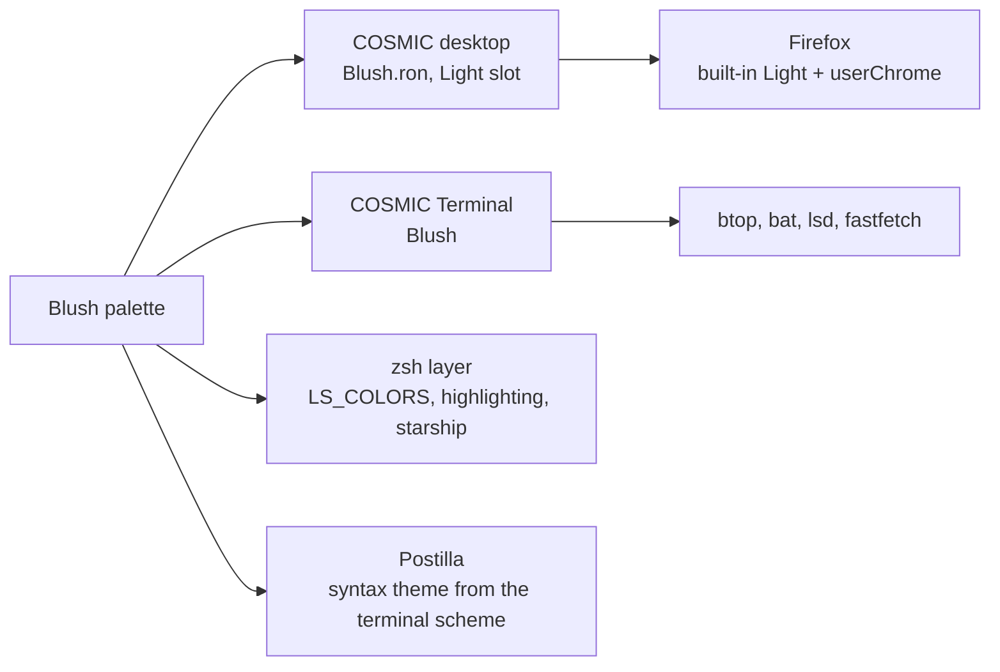

# Blush

> Sand, espresso and rose, with crimson kept for what is wrong. A light rice in desert pinks.

Pop!_OS 24.04 on the COSMIC desktop, one palette carried through the whole
machine: desktop, terminal, shell, editor, browser. This note is the rice
describing itself, written in Markdown and rendered by **Postilla**.

## Palette

Every text colour is checked against the window background  `#F5E6D3`.

| Role | Hex | Contrast on background |
|------|-----|------------------------|
| Text |  `#35302A` | 10.7:1 |
| Rose, accent |  `#9E4F5B` | 4.6:1 |
| Copper, warning |  `#9B5625` | 4.6:1 |
| Crimson, error |  `#A02B16` | 6.0:1 |
| Mocha, success |  `#76634C` | 4.7:1 |
| Walnut, symlinks |  `#644535` | 7.0:1 |
| Cocoa, directories |  `#8C6A4E` | 4.0:1 |
| Muted |  `#756454` | 4.6:1 |

Containers sit one step away from the background at  `#FDF7EE`, which is
what frosted glass blurs into.

## Where the colours go



## Setup, in order

- [x] Import `cosmic/Blush.ron` into Appearance, **Dark** slot
- [x] Import `cosmic-term/Blush-term.ron`, pick **Blush** for the profile
- [x] `./icons/install.sh` for the **Cosmic-Blush** icons, `./cosmic/install.sh` for fonts and the terminal look
- [x] `./zsh/install.sh`, `./lsd/install.sh`, `./fastfetch/install.sh`
- [x] Cursor: Oxygen-Blush-Rose
- [x] Wallpaper: `backgrounds/blush-anime.png`
- [ ] Screenshot for the README

## The baseline every rice shares

```ron
corner_radii: (
    radius_xs: (2.0, 2.0, 2.0, 2.0),   // squared corners
    radius_xl: (2.0, 2.0, 2.0, 2.0),
),
frosted: Low,
frosted_windows: true,
frosted_panel: true,
frosted_applets: true,
frosted_maximized_apps: false,
gaps: (0, 7),
active_hint: 1,
```

Contrast is the WCAG ratio[^1], where $L$ is relative luminance:

```typst
$ (L_1 + 0.05) / (L_2 + 0.05) >= 4.5 $
```

---

*Rendered in Postilla, a Markdown notes app for COSMIC. The window is painted
with this rice's terminal scheme, imported as a syntax theme.*

[^1]: Web Content Accessibility Guidelines, success criterion 1.4.3. Normal text wants 4.5:1, large text 3:1.
